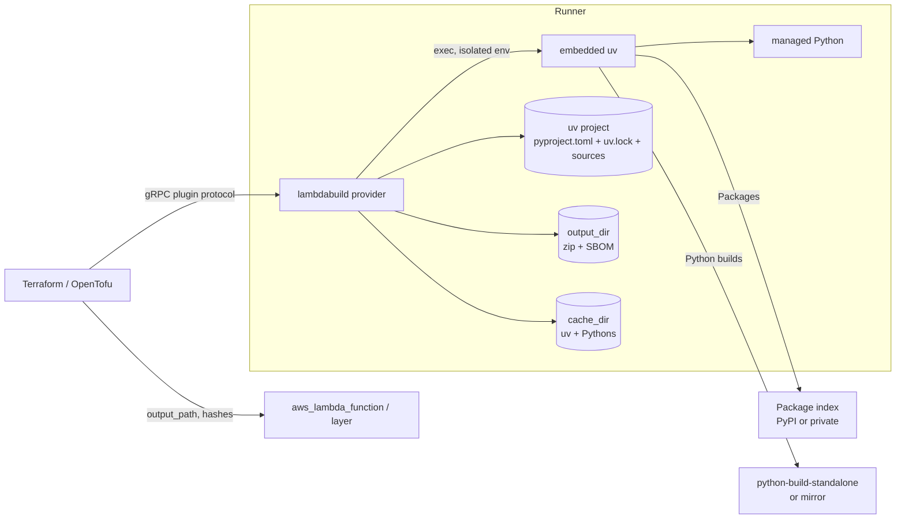
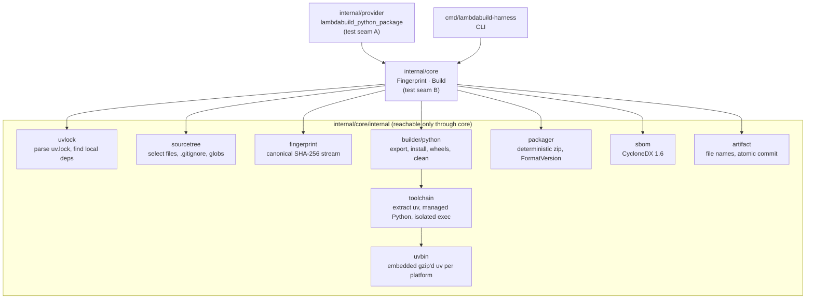
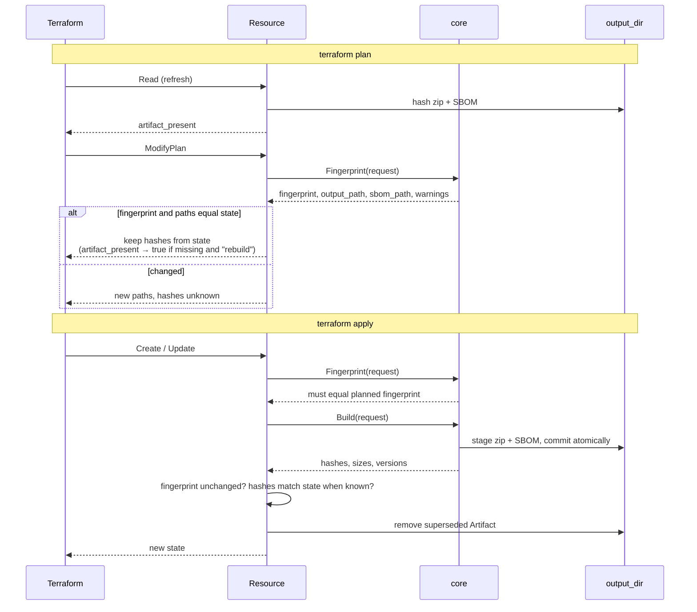

# Architecture

How lambdabuild turns a uv project into a Lambda zip, and why it is built this way. Written for architects evaluating the provider and for contributors changing it. Terms follow [GLOSSARY.md](../../GLOSSARY.md); decisions are recorded in [ADRs](../adr/).

## Goals and constraints

| Goal | What it means in practice |
| --- | --- |
| **Same inputs, same bytes, on every host** | A zip's SHA-256 depends only on the inputs: never on the host OS, paths, clock, environment or caches. Anything that could make output host-dependent is a bug. |
| **Nothing on the host but Terraform** | No Python, pip, uv or Docker on the runner. uv is embedded in the provider binary and fetches its own Python. |
| **Safe on ephemeral CI** | Plan and apply may run on different machines; saved plans must apply; a missing Artifact must be rebuilt without redeploying Lambda. |
| **No secrets in state** | Credentials never pass through provider or resource arguments. |
| **Windows is first class** | macOS, Linux and Windows hosts produce identical Artifacts and are all tested in CI. |

Out of scope: uploading to S3 or calling AWS APIs, container-image Lambdas, resolving dependencies (`uv.lock` is the source of truth). See [ROADMAP.md](../../ROADMAP.md).

## System context



The provider writes local files only. Deploying them is the AWS provider's job, wired through `output_path` and `output_base64sha256`.

## Components



| Package | Responsibility |
| --- | --- |
| `internal/provider` | Terraform schema, plan modification, Create/Read/Update/Delete. Translates resource arguments into a `core.Request` and checks build results against the plan. |
| `internal/core` | The two operations everything else uses: `Fingerprint` (plan time, writes nothing) and `Build` (apply time). Validates the request and resolves defaults into one `buildPlan`, which both operations share so they can never disagree. |
| `uvlock` | Reads `uv.lock`: the project or Workspace member being built, and the local dependencies reachable from it with the selected extras and groups. |
| `sourcetree` | Selects source files by include/exclude globs and `.gitignore` rules (up to the git repository root). |
| `fingerprint` | Streams inputs into SHA-256 in a fixed, length-prefixed format; detects CRLF line endings. |
| `toolchain`, `uvbin` | Extracts and verifies the embedded uv, installs managed Python, runs uv with an isolated environment and redacted errors. |
| `builder/python` | The uv command lines: export pinned requirements, install wheels for the Lambda platform, build project and local wheels, clean host-specific files. |
| `packager` | Writes the zip. Owns `FormatVersion`, the Packaging-format version. |
| `sbom` | Writes the CycloneDX SBOM as a pure function of its input. |
| `artifact` | Names files `<name>-<fingerprint prefix>.zip` and commits zip and SBOM to `output_dir` as one unit. |

The fingerprinter, packager and their peers live under `internal/core/internal/`, so Go's visibility rules stop anything outside `core` from calling them. Tests drive them through `core` (seam B) or through Terraform (seam A); see [testing](../development/testing.md).

## Plan and apply

[ADR 0001](../adr/0001-build-at-apply-not-plan.md): plan only fingerprints; apply builds.



Key properties:

- **Plan is cheap and offline.** Fingerprinting reads files and parses `uv.lock`; it never runs uv.
- **Unknown inputs.** If any argument is unknown at plan (for example `project_dir` from another resource), every derived attribute is unknown.
- **Unreviewed sources never ship.** Apply fingerprints again before building and after building. A mismatch fails with `Build inputs changed since plan` and removes anything written. When sources change between `plan -out` and `apply`, Terraform's own re-plan already fails with `Provider produced inconsistent final plan`.
- **Missing Artifacts are rebuilt, not replaced.** `Read` only refreshes `artifact_present` and never removes the resource from state. With `on_missing_artifact = "rebuild"`, the plan changes `artifact_present` alone, so hashes stay known and dependent Lambda resources plan no change. Apply rebuilds and must reproduce the hashes in state, or fails with `Non-reproducible build`.
- **`on_missing_artifact` never produces a diff.** A custom plan modifier keeps its state value, so a drift-detection job can set `"ignore"` against state written with `"rebuild"`.

## The Input fingerprint

A SHA-256 over a canonical stream:

```text
"lambdabuild-input-fingerprint\n"
"format <Packaging-format version>\n"
"args <len>\n" <canonical JSON of output-affecting arguments> "\n"
for each section ("project", "source", "local <path>" per local dependency):
  "section <name> <file count>\n"
  for each file, sorted by path:
    "file <len(rel)> <rel> <size>\n" <file bytes>
```

- Length prefixes make the stream unambiguous: no two input sets produce the same bytes.
- Arguments are canonical JSON: fixed field order, sorted and de-duplicated lists, `exclude_packages` names normalised per PEP 503. Their JSON names are part of the format.
- Paths are relative with `/`, so a checkout's location and the host's separator never matter. File modes are never hashed.
- The `source` section is the whole project tree when the project ships as a wheel (any file could be package data), otherwise the `source_include` files that are copied.
- The uv version is deliberately excluded ([ADR 0003](../adr/0003-uv-version-not-in-fingerprint.md)); golden tests gate uv upgrades instead.

The first 16 hex characters name the output files, so `output_path` is known at plan and changes exactly when the Artifact would.

## The build pipeline

`core.Build` for a function with dependencies and an installable project:

1. **Resolve the plan.** Validate arguments, parse `uv.lock`, find the project or Workspace member and its reachable local dependencies, default `install_project` from `[build-system]`, derive the platform tag from the Python version (`manylinux_2_34` for 3.12+, Amazon Linux 2023; `manylinux_2_26` before).
2. **Fingerprint** as at plan.
3. **Toolchain.** Extract the embedded uv into `cache_dir` if missing (checksum-verified), install the managed Python under a lock.
4. **Third-party Packages.** `uv export --locked --no-dev --no-default-groups --no-emit-project --no-emit-local` writes pinned requirements with hashes; `uv pip install --require-hashes --only-binary :all: --python-platform <arch>-manylinux_X_Y --target staging` installs Linux wheels for the target regardless of host. The install reads no project configuration except a generated file holding the project's `[[tool.uv.index]]` entries.
5. **Project and local wheels.** Each tree is copied (only its fingerprinted files) to a temp directory and built with `uv build --wheel`, then all wheels install with `--no-deps`. Building from the copy means the wheel cannot contain a file the fingerprint did not see, and build backends that write `build/` or `*.egg-info` never touch the user's tree.
6. **Clean.** Remove `bin/`, `__pycache__`, `.pyc`, `direct_url.json`, uv's `.lock` and `uv_cache.json`; drop their lines from every `RECORD`. Apply `exclude_packages`.
7. **Size check.** Over 250 MB unpacked fails (or warns with `size_limit_mode = "warn"`) and lists the largest Packages.
8. **Package.** Write the zip (function: content at root; layer: under `python/`) and the SBOM to temp files in `output_dir`, then rename both into place.

A code-only build (`install_dependencies = false`, no project wheel) skips steps 3 to 6 and never runs uv.

## Packaging rules

Owned by `packager` and `sbom`. Changing any of them changes Artifact bytes from unchanged inputs, so it requires bumping `packager.FormatVersion` and a **One-time redeploy** changelog entry ([policy](../../CHANGELOG.md)).

- Entries sorted by path in byte order; `/` separators; duplicate or unsafe names (absolute, `..`, `\`) rejected.
- Every entry dated 1980-01-01 00:00:00 UTC, deflated at `BestCompression`.
- Mode from content: ELF or `#!` gives `0755`, anything else `0644`.
- SBOM: CycloneDX 1.6 JSON, fixed key order, sorted components, no timestamp, serial number a UUIDv5 of the zip hash, LF newlines.

Go's `compress/flate` output is part of the bytes, so a Go upgrade is checked by the golden tests like a uv upgrade.

## Toolchain and isolation

[ADR 0002](../adr/0002-embed-uv-as-subprocess.md): uv is a Rust binary, so the provider embeds one gzip-compressed binary per release platform (selected by build tags) and runs it as a subprocess. Linux uses Astral's static musl builds, so the provider runs on glibc and Alpine alike.

- **Supply chain.** `mise run uv:fetch` downloads the pinned release and checks it against archive SHA-256s committed in `uvbin/checksums.txt`. The binary's own SHA-256 is compiled in and verified again at extraction.
- **Isolated environment.** The uv child process gets the host environment minus every `UV_*` variable (except `UV_INDEX_<NAME>_USERNAME` / `_PASSWORD`), with user config directories pointed at an empty folder and `UV_NO_SYSTEM_CONFIG=1`. Managed Python is forced (`UV_PYTHON_PREFERENCE=only-managed`) and installed under `cache_dir`, never into the user's `bin` or the Windows registry. Provider arguments are overlaid as `UV_DEFAULT_INDEX`, `UV_INDEX`, `UV_NATIVE_TLS`, and so on.
- **No shell.** Every uv call is a direct exec with an argument list.

## Security model

| Concern | Control |
| --- | --- |
| Credentials in state or plan files | URL arguments with userinfo are rejected at validation; credentials come only from `UV_INDEX_<NAME>_*` variables in the process environment. |
| Credentials in logs | uv's stderr is scrubbed before it becomes a Terraform diagnostic: URL userinfo, index credential values and any variable named like `*PASSWORD*`, `*TOKEN*` or `*SECRET*`. |
| Tampered Packages | Third-party installs use `--require-hashes` against `uv.lock`; the install ignores `[tool.uv.pip]`, which could switch hashing off. |
| Tampered uv | Checksums pinned in the repo at fetch time and compiled in at build time. Releases are GPG-signed through the Terraform Registry. |
| Host config leaking in | User and system uv config and inherited `UV_*` settings are neutralised. |
| Native code from source | Only wheels are installed (`--only-binary :all:`); no source distribution of a third-party Package is built on the host. |

The project's own wheel and its local dependencies are built by their declared build backend, which runs code from the project, as any `pip install .` does.

## Concurrency and file safety

Concurrent builds, in one Terraform run or across processes, may share `cache_dir` and `output_dir`:

- **uv extraction**: a per-version lock file, re-check under the lock, write to a temp file and rename. A running uv is never overwritten (macOS kills a process whose signed binary changes).
- **Managed Python**: install and lookup under a lock; builds run the interpreter from its patch-version folder, not uv's minor-version link, which uv recreates without a lock.
- **Artifacts**: zip and SBOM are staged as uniquely named temp files in `output_dir` and renamed into place, SBOM first; a failure removes both. On Windows, renames retry while another process holds the file.

Locks and renames have `_unix.go`, `_windows.go` and `_other.go` variants.

## Extending to other runtimes

Fingerprinting, packaging, hashing and the resource lifecycle are runtime-neutral. A new runtime (Node.js is the first candidate) would add a builder that lists its inputs and stages files, behind its own resource such as `lambdabuild_node_package`. The interface sketch and candidates are in [ROADMAP.md](../../ROADMAP.md#more-runtimes).

## Decision records

| ADR | Decision |
| --- | --- |
| [0001](../adr/0001-build-at-apply-not-plan.md) | Build Artifacts at apply, not at plan |
| [0002](../adr/0002-embed-uv-as-subprocess.md) | Embed uv in the provider binary and run it as a subprocess |
| [0003](../adr/0003-uv-version-not-in-fingerprint.md) | Leave the uv version out of the Input fingerprint |
